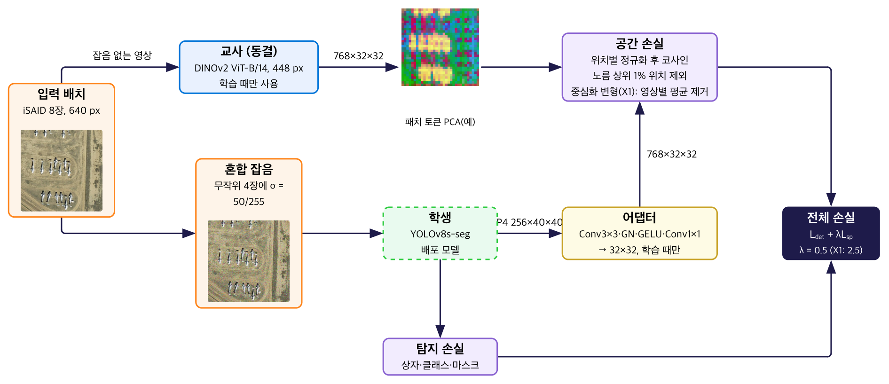

# Noise-Robust Object Detection via Heterogeneous ViT → CNN Knowledge Distillation

**Graduation thesis / capstone, Chungbuk National University (Dept. of Electronic Engineering), 2026.**
DINOv2 (ViT) → YOLOv8s-seg (CNN): mixed-noise training plus **centred spatial distillation** keeps a lightweight detector working under satellite sensor noise. The teacher and the adapter are removed at inference, so the deployed model is unchanged (11.8M parameters / 22 MB, no extra inference cost).

> ML and all code: **Juhyeok Park**. Data preparation and documentation: Jiwon Lee. Advisor: Prof. Hyeongwon Kim.
> 🔗 [Project page with figures](https://nonojamjam.github.io/noise-robust-detection-rkd/) · **Full details, code and raw numbers: [`fall2026/`](fall2026/README.md)**



*Training pipeline (thesis Fig. 1, Korean labels): DINOv2 patch tokens (768×32×32) are aligned to the student's neck P4 feature through a training-only adapter; half of each batch gets Gaussian noise σ = 50/255.*

## Results

Official iSAID split (1,411 / 458 scenes → 18,732 / 6,048 patches, no shared scene), label prefix removed, 10 epochs, box mAP50, evaluation noise Gaussian σ = 0.3. Every checkpoint was re-evaluated on the same GPU with the same noisy images.

| Condition (seed 0) | Clean | Noisy | Noisy − S0 |
|---|---|---|---|
| BL0 — no noise training* | 0.631 | 0.018 | — |
| S0 — noise training, no KD | 0.597 | 0.381 | — |
| N1 — + image-level relational KD | 0.593 | 0.382 | +0.001 |
| S1 — + plain spatial KD, λ 0.5 | 0.596 | 0.374 | −0.008 |
| S2 — S1 with teacher positions shuffled | 0.591 | 0.384 | +0.003 |
| **X1 — + centred spatial KD, λ 2.5** | **0.611** | **0.401** | **+0.020** |
| X2 — X1 with teacher positions shuffled | 0.587 | 0.375 | −0.006 |
| P — plain spatial KD, λ 2.5 | 0.606 | 0.391 | +0.009 |

\* trained on an RTX 3060 Ti with a different software stack; all other rows on Kaggle T4 with a pinned Docker image.

- **Noise training does most of the work** (0.018 → 0.381).
- **Relational KD and plain spatial KD add nothing measurable.**
- **Centred spatial KD** beat S0 on both training seeds (+0.020 / +0.010) and also raised clean mAP; paired bootstrap on seed 0: [+0.015, +0.024]. With the teacher's positions shuffled (X2) the gain disappeared (seed 0).
- Across evaluation noise σ = 0.1–0.3 X1 led on both seeds; at σ = 0.4 the sign depends on the seed.

Limitations: two seeds for the main comparison, one for the controls; centring and λ changed together (P lands in between); Gaussian noise and iSAID only. See [`fall2026/README.md`](fall2026/README.md).

## Repository layout (this branch)

```
fall2026/README.md                     # method, all results, diagnostics, reproduce
fall2026/code/seed_sweep_v2_8465ec15.py  # exact training script used for every thesis run
fall2026/code/eval_ci.py               # re-evaluation + paired bootstrap
fall2026/kaggle/                       # Kaggle notebook generators (S*, X*/P, N1)
fall2026/data_split/                   # official split lists + audit
fall2026/results/eval_official/        # raw evaluation summaries (incl. σ sweep)
src/, eval/, results/, configs/        # June 2026 version (relational KD), kept as a record
```

## June 2026 version

The `main` branch and the `src/` code here are the June 2026 capstone presentation version (image-level relational KD, CLS token, SPPF feature). Its numbers were measured on a public Kaggle conversion of iSAID whose validation tiles were mostly byte-identical to training tiles, with a label-parsing bug that inflated boxes, and are superseded by the results above. Details: [`main` → Known issues](https://github.com/nonojamjam/noise-robust-detection-rkd#known-issues-found-after-the-june-presentation).
