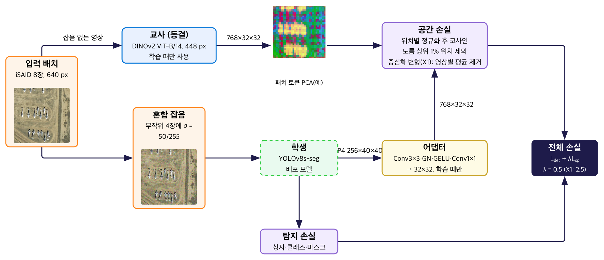

# Fall 2026 follow-up: heterogeneous spatial KD (DINOv2 → YOLOv8s-seg) on the official iSAID split

This branch holds the work done **after** the June 2026 capstone presentation. The `main` branch keeps the June presentation version (with its Known issues). Numbers here are **not comparable** to the June numbers. The experiments are frozen as of 2026-11-07; the results below are the final thesis numbers.

## Why this branch exists
An audit after June found two problems that affect the June numbers (see `main` → Known issues 3 and 4):
- **Train/val overlap.** In the Kaggle conversion we used, 7,926 of 8,919 validation tiles are byte-identical to training tiles.
- **Label prefix.** Every label line starts with `cls cx cy w h` before the polygon. The loader read those four values as extra vertices, which inflated the ground-truth boxes.

The 10-epoch runs in the results table use the **official iSAID train/val scene split**: 1,411 train scenes / 458 val scenes, 18,732 / 6,048 tiles, 0 shared scenes. The lists are in `data_split/` (sha256 `246efa0a…` / `be763a31…`). Labels have the prefix removed, and evaluation uses `last.pt`.

## Method (what changed from June)

*Training pipeline (figure 1 of the graduation thesis, Korean labels).*

- **Teacher.** Frozen DINOv2 ViT-B/14. Input is 448 px with ImageNet normalization, and the teacher uses **patch tokens (32×32)** instead of the CLS token.
- **Student.** YOLOv8s-seg. KD is applied at neck P4 (`model[18]`, 256×40×40) through a training-only adapter (Conv3×3 → GN → GELU → Conv1×1 → resize to 32×32). The adapter is removed at inference.
- **Loss.** `L = L_det + λ·L_sp`, where `L_sp` is a per-position cosine distance after a fixed LayerNorm, averaged over positions except the 1 % highest-norm teacher tokens per image. The teacher always sees the clean image; half of each batch gets Gaussian noise σ = 50/255.
- **Conditions.** All include 50:50 noise training; only the loss differs.

| Condition | Description | Seeds |
|---|---|---|
| BL0 | No noise training, no KD (reference; different GPU/software, see below) | 0 |
| S0 | Same path as KD runs, λ = 0 (no KD) | 0, 1 |
| N1 | S0 + the June image-level relational KD (CLS token, distance-wise RKD) | 0, 1 |
| S1 | Spatial KD, plain loss, λ = 0.5 | 0 |
| S2 | S1 with teacher tokens randomly shuffled across positions (control: is spatial correspondence what matters?) | 0 |
| X1 | Exploratory: **centred** loss (per-image mean token removed from teacher and student before cosine), λ = 2.5 | 0, 1 |
| X2 | X1 with shuffled teacher tokens (control for X1) | 0 |
| P | Plain loss at λ = 2.5 (separates centring from λ) | 0 |

  X1 was added after a diagnostic run showed the plain loss pulling student features toward one position-independent direction. It changes the loss form and λ together; P checks λ alone.
- **Code.** `code/seed_sweep_v2.py`. Each condition is selected by the settings the notebook generators write (`EXP`, `LAM_SP_SHARED`, `KD_LOSS_VARIANT`); the script's own defaults are not one of these conditions. The other loss variants and training options in that file are opt-in and exploratory.

## Results — official split, 10 epochs (box mAP50, noisy = Gaussian σ = 0.3)

These are the numbers in the graduation thesis (v2.1, Chungbuk National University, in preparation). Every checkpoint (`last.pt`) was **re-evaluated** with `code/eval_ci.py` on the same GPU and the same noisy images, so they differ slightly from the training-log values in `results/*_result.json` (e.g. S0 noisy 0.3813 vs 0.3827). Raw summaries: `results/eval_official/`.

**Seed 0**

| Condition | clean | noisy | noisy, small objects* | noisy − S0 |
|---|---|---|---|---|
| BL0 (no noise training)† | 0.6310 | 0.0178 | 0.0104 | — |
| S0 (no KD) | 0.5974 | 0.3813 | 0.2419 | — |
| N1 (relational KD) | 0.5926 | 0.3820 | 0.2438 | +0.0007 |
| S1 (plain, λ 0.5) | 0.5960 | 0.3738 | 0.2398 | −0.0075 |
| S2 (S1 shuffled) | 0.5907 | 0.3841 | 0.2446 | +0.0028 |
| **X1 (centred, λ 2.5)** | **0.6115** | **0.4009** | **0.2525** | **+0.0195** |
| X2 (X1 shuffled) | 0.5873 | 0.3752 | 0.2448 | −0.0061 |
| P (plain, λ 2.5) | 0.6060 | 0.3906 | 0.2484 | +0.0093 |

\* approximate AP50 for boxes under 32² px at 640 px input (not COCO small AP). † trained on an RTX 3060 Ti with a different software stack; all other rows on Kaggle T4 with a pinned Docker image.

**Seed 1** (noisy): S0 0.3875 · N1 0.3858 · X1 0.3970 → X1 − S0 = +0.0095, N1 − S0 = −0.0017. Clean: S0 0.5875 · N1 0.5896 · X1 0.6045.

**Reading.**
- Noise training does most of the work (BL0 → S0: 0.018 → 0.381).
- Relational KD (N1) and plain spatial KD at λ 0.5 (S1) add nothing measurable.
- Centred spatial KD (X1) beat S0 on both seeds (+0.020, +0.010) and also raised clean mAP. A paired bootstrap over the 6,048 validation patches (1,000 resamples, seed 0) gives X1 − S0 noisy [+0.015, +0.024] (`results/eval_official/ci.json`); patches come from 458 source images, so this interval is likely too narrow and covers evaluation-sample variation only.
- With teacher positions shuffled, X2 fell 0.026 below X1 and 0.006 below S0 (seed 0 only).
- P (λ 2.5 without centring) landed between S0 and X1, so the effects of centring and λ are not separated.

**Noise-level sweep** (`results/eval_official/sigma_sweep/`, same checkpoints re-evaluated): X1 > S0 at σ = 0.1, 0.2, 0.3 on both seeds (+0.010 to +0.022). At σ = 0.4 seed 0 is +0.017 but seed 1 is −0.016. At σ = 0.3, all 6 combinations of training seed (2) × noise sample (3) favour X1 (+0.009 to +0.020).

## Diagnostics
- **KD signal was small in the plain loss.** The ratio `λ·L_sp / (per-image detection loss)` was about 0.02 for S1 (plain, λ = 0.5; 10-epoch log) — and about 0.04 for the centered loss at λ = 0.5 in 1-epoch diagnostic runs. X1 used λ = 2.5, which put the ratio at about 0.18 (10-epoch log).
- **Alignment did not coincide with robustness in this run.** In the 10-epoch S1 run, the adapter output retrieves the matching teacher token at 0.055 P@1 (chance 0.001), yet noisy mAP is 0.008 below S0 (one seed).
- **Backbone linear probe.** We fit a ridge regression from student P4 to the teacher tokens. These checkpoints were trained for 1 epoch on the *old* split, so treat this as a diagnostic only. Files: `results/probe_1ep_ctx{1,3}.json`.

| Checkpoint | P@1 (1×1 context) | P@1 (3×3 context) |
|---|---|---|
| S2 (shuffled) | 0.0126 | 0.0213 |
| S0 (no KD) | 0.0129 | 0.0219 |
| S1 plain | 0.0153 | 0.0254 |
| COCO-pretrained (before iSAID) | 0.0167 | 0.0254 |
| S1 centered | 0.0208 | 0.0332 |

  In this table (1-epoch, old-split checkpoints, one seed), the shuffled-KD checkpoint is at the S0 level, plain KD is slightly higher, and the centered loss is highest. These are not the 10-epoch models above, and other loss variants we screened later (e.g. a contrastive one) reached a higher probe score without better noisy mAP — so probe scores should not be read as predicting robustness.

## Reproduce
- `code/seed_sweep_v2_8465ec15.py` is the exact training script (sha256 `8465ec15…`) embedded in every thesis notebook. `code/seed_sweep_v2.py` (`64b55605…`) is a later copy with opt-in options.
- Notebook generators (set `KAGGLE_USERNAME`): `kaggle/make_v23.py` (S0, S1, S2), `kaggle/make_v23x_8465.py` (X1, X2, P), `kaggle/make_v23n1.py` (N1). Each embeds the code and split lists and checks their sha256 before training.
- `code/eval_ci.py extract` re-evaluates a checkpoint (clean and σ = 0.3, fixed noise seed) and stores per-image records; `code/eval_ci.py boot` runs the paired bootstrap.
- Dataset: Kaggle `redzapdos123/isaid-dataset-yolo11-seg-format`. The code builds a symlink mirror from the official lists and strips the label prefix itself.
- Tests: `code/tests/test_spatial_kd.py` (some tests need reference files that are not in this repo) and `analysis/test_probe_core.py`.

## Limitations
- Two training seeds for S0, N1, X1; one for the others. The judgement threshold was fixed in advance, not derived from seed-to-seed spread.
- Centring vs λ is separated only by one P run; λ was tried at 0.5 and 2.5 (plain) and 2.5 (centred).
- Gaussian noise only; the main comparison is at σ = 0.3, and at σ = 0.4 the sign depends on the seed.
- 10 epochs, mosaic augmentation effectively off (`close_mosaic = 10`). BL0 was trained on a different GPU/software stack.
